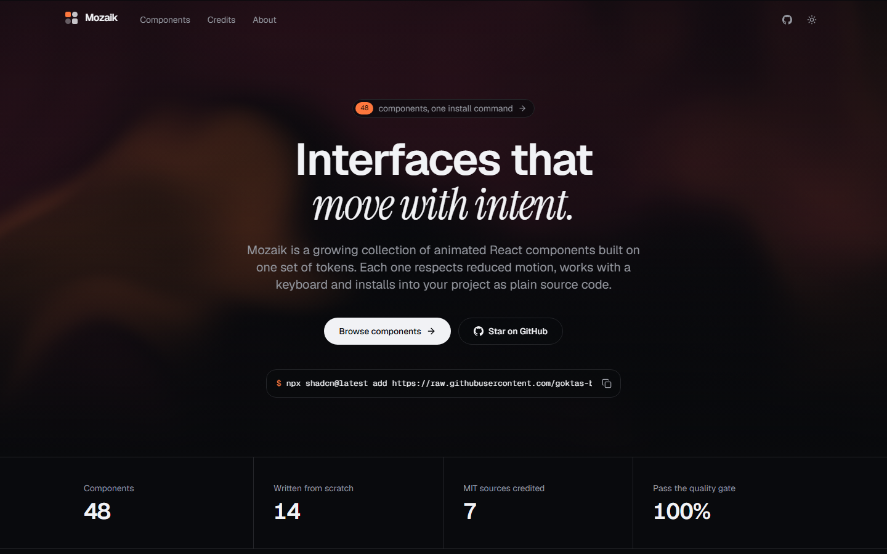
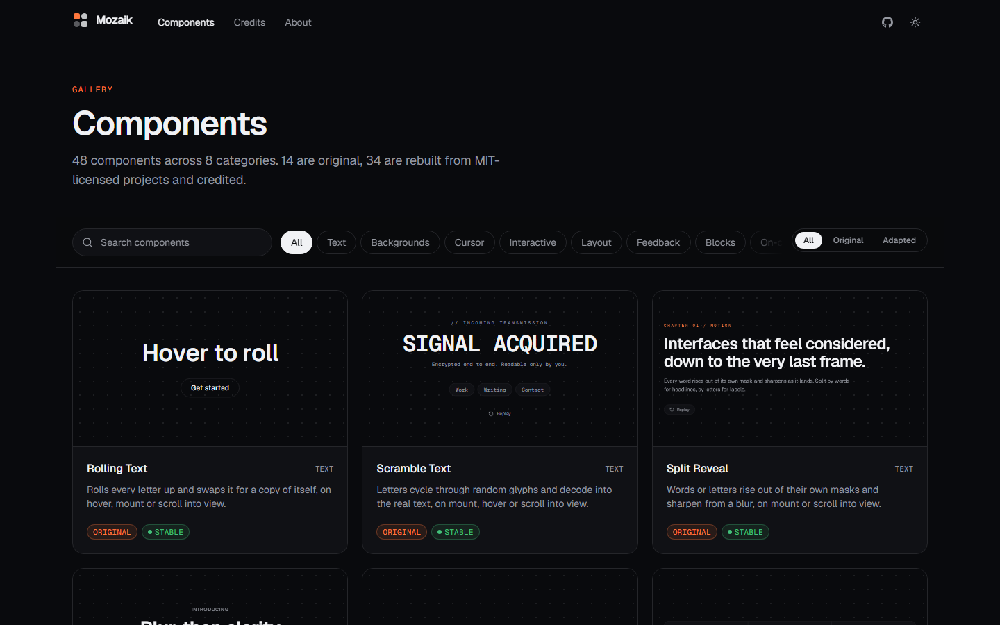
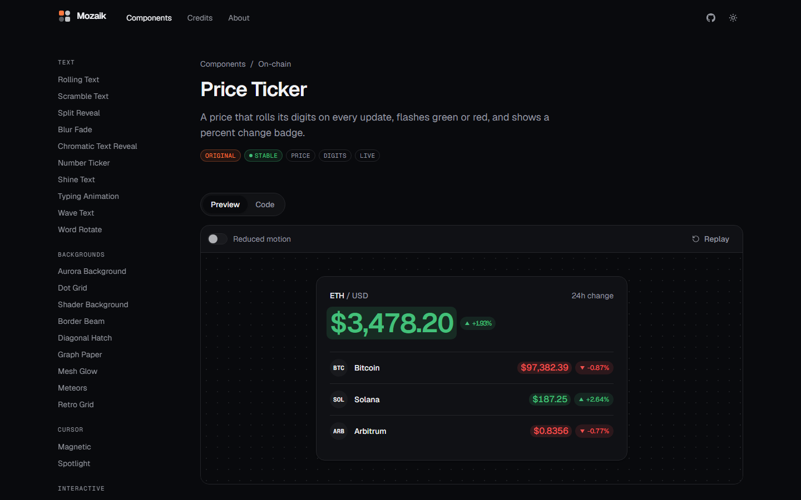

# Mozaik Site

**Live: https://goktas-batuhan.github.io/mozaik-site/**

The live gallery and documentation for [Mozaik](https://github.com/goktas-batuhan/mozaik): 48 animated React components in one design language, installable with the shadcn CLI.



Every component on this site was installed from the public Mozaik registry with `npx shadcn add`, the same way you would install it. The gallery doubles as an end-to-end test of the install path.

## Pages

| Route | What it shows |
| --- | --- |
| `/` | Hero on a live WebGL shader, numbers, a bento of running components, the quality gate |
| `/components` | Gallery with search, category and layer filters; previews load as they scroll into view |
| `/components/:name` | Live preview with a reduced-motion switch and replay, source code, install steps, usage, props table, source and license |
| `/about` | The author and what the project demonstrates |

| Gallery | Component page |
| --- | --- |
|  |  |

## How it is built

- **Install, don't copy.** `npm run sync` runs `shadcn add` for every registry item into `src/components/mozaik/`, writes each demo into `src/demos/` and highlights the source with Shiki at build time into `src/data/docs/`. Nothing is highlighted in the browser.
- **Reduced motion you can try.** The preview switch wraps the demo in `<MotionConfig reducedMotion="always">`; every Mozaik component listens to it as well as to the OS setting.
- **Fits any screen.** A small `Stage` component lays a demo out at its natural width and scales it to the space available, so fixed-width demos are never clipped on a phone.
- **Prerendered and hydrated.** Each of the 51 routes is rendered to HTML at build time (`src/entry-server.tsx`, `scripts/prerender.mjs`, React 19 `prerender`) with its own title, description and font preloads, then hydrated in place. The home page below the fold hydrates selectively when its chunk arrives.
- **Light on the first load.** Main chunk about 67 KB gzip (the hero animates with CSS, not Motion). Routes other than the home page are lazy chunks, the home page below the fold is its own chunk, the WebGL hero compiles on first interaction (or after 6 s) so it never blocks the main thread during load, and demos and docs load per component.
- **Tested.** Playwright visits all 51 routes and fails on any runtime error; axe checks the main pages against WCAG 2 A/AA.

## Numbers

Lighthouse on the live site (GitHub Pages, home page, 2026-10-26): **mobile 99 / 100 / 100 / 100, desktop 100 / 100 / 100 / 100** (performance / accessibility / best practices / SEO).

Local production build, served without a CDN:

| Profile | Performance | Accessibility | Best practices | SEO |
| --- | --- | --- | --- | --- |
| Desktop (home, gallery, component page) | 99 | 100 | 100 | 100 |
| Mobile, simulated slow 4G (home, gallery, component page) | 84–87 | 100 | 100 | 100 |

The mobile numbers come from Lighthouse's simulated slow 4G with a 4× CPU slowdown. In the observed trace of the same runs, the largest contentful paint lands with the first paint at about 0.3 s, because every page ships as prerendered HTML.

## Development

```bash
npm install
npm run dev        # http://localhost:5173
npm run sync       # reinstall components from ../mozaik (or MOZAIK_REGISTRY=<url>)
npm run build      # typecheck, client build, SSR build, prerender
npx playwright test
```

`npm run sync` serves `../mozaik/public` locally by default. Point it at the published registry with:

```bash
MOZAIK_REGISTRY=https://raw.githubusercontent.com/goktas-batuhan/mozaik/main/public npm run sync
```

## Deploy

Static output, zero runtime cost.

- **GitHub Pages (live):** `npm run build:pages` builds under `/mozaik-site/`; the `dist/` folder is published to the `gh-pages` branch. `404.html` lets deep links fall back to the client router.
- **Vercel (optional):** framework preset Vite, build command `npm run build`, output `dist`. `vercel.json` rewrites unknown paths to the SPA.

## Tech

React 19 · TypeScript · Tailwind CSS v4 · Motion · React Router · Vite · Shiki · Playwright · axe-core

## License

MIT. Component credits live in the [Mozaik repository](https://github.com/goktas-batuhan/mozaik/blob/main/CREDITS.md) and on every component page.
